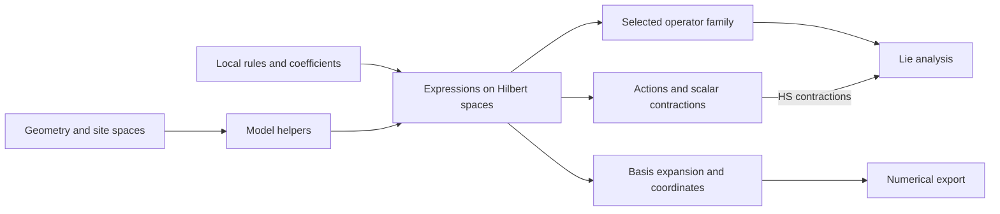

# syntaqs architecture overview

Updated: 2026-11-17

## 1. Overall structure

syntaqs turns local algebra rules into shared expressions on ordered Hilbert
spaces. Callers can evaluate those expressions directly, choose a basis for
numerical output, or select an operator family for Lie analysis. Geometry-based
model helpers construct the same expression types.

The following diagram shows computation flow, rather than crate dependencies.
The [requirements](requirements.md) define accepted scope; the
[feature designs](README.md#2-feature-details) specify individual contracts.

## 2. Crates and responsibilities

The workspace contains nine libraries and three packages for examples,
integration tests, and shared internal BLAS/LAPACK support.

| Crate / package | Provides |
| --- | --- |
| `syntaqs-core` | Local algebra traits, coefficient capabilities, finite linear combinations, local/composite expressions, Hilbert spaces, construction, evaluation, bases, and coordinates. |
| `syntaqs-basic` | Standard UUID and named indices. |
| `syntaqs-geometry` | Chains, boundaries, site relations, and borrowing connections to caller-owned data and space sequences. |
| `syntaqs-normalize` | Extension traits for norms, state normalization, and normalized expectations. |
| `syntaqs-export` | Vec, ndarray, and sprs output with interpretation metadata. |
| `syntaqs-lie` | Operator families, real HS projection, Lie brackets and closure diagnostics, retained adjoint/Killing representations, real family transformations, full real adjoint commutants, center/complement extraction, complete simple-ideal decomposition, and dense numerical foundations. |
| `syntaqs-spin-half` | Spin-1/2 primitives and bases, and XYZ/Heisenberg models. |
| `syntaqs-spin-one` | Spin-1 primitives and bases, and XYZ/Heisenberg/BLBQ construction. |
| `syntaqs-fermion` | Single-mode fermion primitives and bases, and standard/symmetric Hubbard construction. |
| [examples](../examples/README.md) | Runnable examples using the individual crates directly. |
| [syntaqs-tests](../tests/README.md) | Shared custom-algebra fixtures and public-API integration tests. |
| [blas-provider](../support/blas-provider/README.md) | Internal system OpenBLAS selection shared by development, examples, and verification; kept under `support/` and not published. |

## 3. Dependency direction

Core owns the shared expression and evaluation machinery. Concrete algebras
connect their local rules and bases through public traits, so they reuse that
machinery. Core is independent of basic, geometry, normalize, export, lie, and
the concrete algebras.

Geometry, normalize, export, lie, and the three concrete algebras depend on core. Each algebra's model construction uses geometry. Basic depends on core only for tests and doctests; UUID generation stays in basic. Lie owns its deterministic decomposition sampling stream. Production libraries do not depend on examples, syntaqs-tests, or the development BLAS provider.

Core, geometry, spin-half, and fermion use `no_std + alloc`; basic, normalize, export, lie, and spin-one use std. Export has no default features, always supports Vec, and independently enables ndarray and sprs. Lie enables ndarray BLAS and retains native linkage through provider-neutral blas-src; applications select a source supplying BLAS and LAPACK.

## 4. Main data and operations

| Object | Role and relationships |
| --- | --- |
| Primitives and coefficients | Types and individual capability implementations define local states, operators, and rules. Numeric bounds belong to each operation. |
| `HilbertSpace<I>` | Retains factor identity, order, grouping, and ordinary/graded composition; it does not store local algebra, dimension, or basis. |
| Local/composite expressions | Share immutable nodes and delay sums, products, actions, and adjoints. States have a definite space; operators have an optional ambient-space binding. |
| `ExpressionFactory` / `QuantumSystem` | Separate construction from primitive/coefficient type information. `SpinHalf<C>` and related names are factory aliases. |
| Evaluation | Uses the selected space and local rules. Ordinary and graded calculations share an API; core handles signs from order and parity. |
| `Basis` / `Coordinates` | Select a basis per operation for ordinary-expression expansion, sparse coordinates, and lazy enumeration. Expression nodes do not retain basis metadata. |
| `Exported` | Associates numerical data with basis, space, shape, and layout. Action-matrix columns come from acting on state-basis elements. |
| `OperatorFamily` | Ordered local/placed operator candidates, explicit validation, real HS projection, and real family transformations. |
| Retained Lie results | Structure constants, adjoint matrices, Killing forms, and invariant subspaces in selected operator-family coordinates. |
| `LieDecomposition` | The full center and nonabelian simple ideals, reconstructed in the original expression context with complete-splitting diagnostics. |
| `Chain` / `SiteMapper` | Borrow geometry and caller-owned site-ordered data. Callers issue indices and construct, retain, and order the spaces. |

A typical calculation starts with indices and spaces, followed by primitive and
coefficient types, then local-expression placement and composition. Actions and
scalar contractions need no matrix. Expansion and physical numerical output
add an explicit state or operator basis.

Lie analysis selects a family of operator expressions and constructs dense
coefficient arrays in that family's dimension. It uses core HS contractions
without physical action-matrix export; see [Lie contracts](design/lie.md).

## 5. Module structure

Core is divided into `algebra`, `coefficient`, `space`, `system`, `expression`, `basis`, and private `evaluate` modules. Algebra operations and grading belong to `algebra`; `space` defines both `Dimension`, which describes a primitive's span, and `DimensionOverflow`. Public expression handles are defined in `expression::local` and `expression::composite`; linear combinations are defined in `expression::parts::linear_combination`. Expression nodes and traversal are private.

Other module boundaries follow their responsibilities:

| Component | Module responsibilities |
| --- | --- |
| Geometry | Boundaries and geometries, site relations, and site-to-data mapping. |
| Normalize | Norms, expectations, and errors. |
| Export | Arguments/results, metadata, coordinate/vector/matrix conversion, and backends. |
| Lie | Expression adapters, families/transformations, representations, invariant subspaces, decomposition, and numerical foundations. |
| Concrete algebras | Primitives, coefficient helpers, bases, and models. |

Feature designs specify the detailed types, capabilities, errors, and processing.

Public items use their defining semantic module paths. Each library crate has a root `prelude` re-exporting frequently used items; other public re-exports are not used. A crate root may itself define a shared abstraction or a system alias. Within this repository, crates other than `examples` import dependencies through their defining paths rather than another syntaqs crate's prelude, including in tests and documentation examples.

Named Rust modules use `name.rs` and, for children, a `name/` directory; crate entry points are excluded. The shared integration-test helper layout is described in [verification](design/verification.md#1-verification-responsibilities).

See [verification](design/verification.md) for checks, [future work](future-work.md) for unimplemented extensions, and the [documentation guide](README.md) for document responsibilities and maintenance conventions.
